

<Frame>
  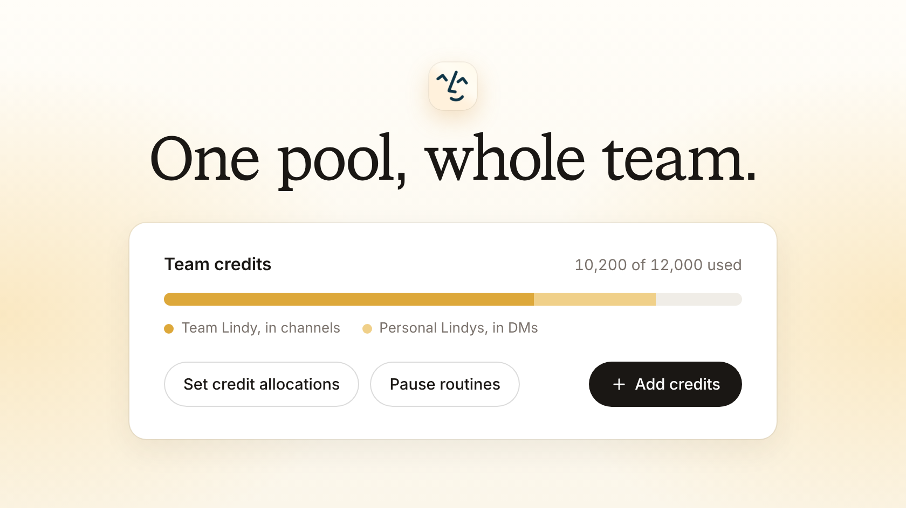
</Frame>

Credits cost **$0.01 each on base plans**. Your team shares one pool. Every seat adds to it. Both the shared Lindy in your channels and the private Lindy in each person's DMs spend from it.

This page covers what uses credits, why Lindy sometimes pauses to check in, and how to get more. For seats, pricing, and trials, see [Lindy Teammate Billing](/teammate/lindy-teammate-billing).

  <Frame>
    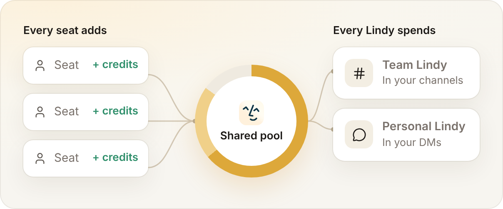
  </Frame>
  <Frame>
    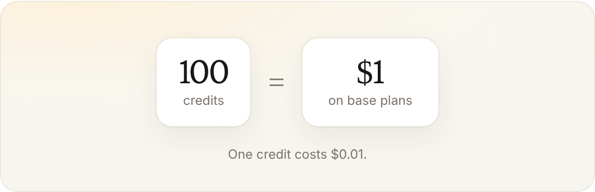
  </Frame>

## Usage Warning: Why Am I Seeing This?

Lindy paused because a task is using far more credits than usual. This safeguard gives you a chance to decide whether to keep going.

Lindy asks in the Slack thread if you @mentioned it in a channel, or in your DM if you asked there.

- Select **Continue** to finish the task normally.
- Select **Stop** to stop using credits on the task. The thread stays open, so you can pick it up later.

<Frame>
  
</Frame>

## Credit Usage by Feature

Credits pay for the work Lindy does. These tables show roughly what each kind of work draws from your pool.

### Your team's Lindy, in your channels

Shared by the whole team and drawing on your approved team sources. Most credits go here, because everyone @mentions the same Lindy.

| What Lindy does | Credit impact |
|---|---|
| Answering a question from approved team sources | Low |
| Pulling a report or a lookup from a connected tool | Low |
| Drafting a client update, summary, or document | Moderate |
| Team routines, priced by how often they run | Moderate |
| Deep research across channels and Drive folders | Varies |

### Your personal Lindy, in your DMs

Private to each person and much lighter. Automatic updates such as daily briefs and meeting prep help you stay ahead of your day.

| What Lindy does | Credit impact |
|---|---|
| Daily brief | Very low |
| Email alerts on time-sensitive mail | Very low |
| Open-loop nudges when an ask goes unanswered | Very low |
| Meeting prep briefings | Very low |
| Catch-up summaries when you're @mentioned in a busy channel | Low |
| Meeting recaps and notes | Low |
| Ad hoc research you delegate in a DM | Varies |
| [Phone calls](/features/phone-line) | From 25 credits per minute |

Lindy's phone number has a separate monthly fee, billed with your plan.

<Frame>
  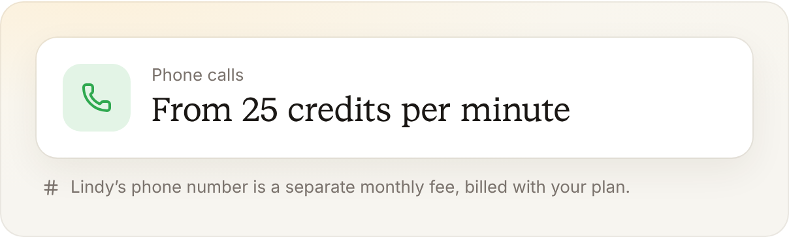
</Frame>

Both Lindys spend from the same pool. A busy channel where the whole team @mentions Lindy uses credits faster than any one person's DMs.

Monthly plan credits reset at the start of each billing cycle and don't roll over. Top-up credits stay until you use them.

<Frame>
  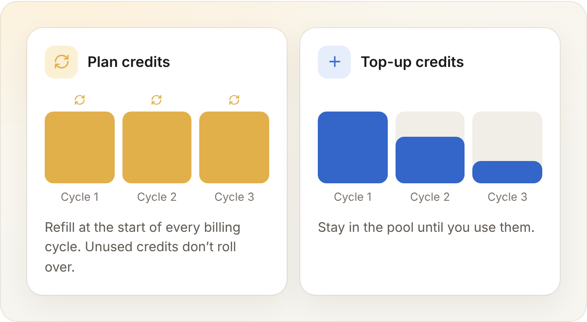
</Frame>

## Checking your usage

Open **Settings → Usage** to see how your workspace uses credits.

<Frame>
  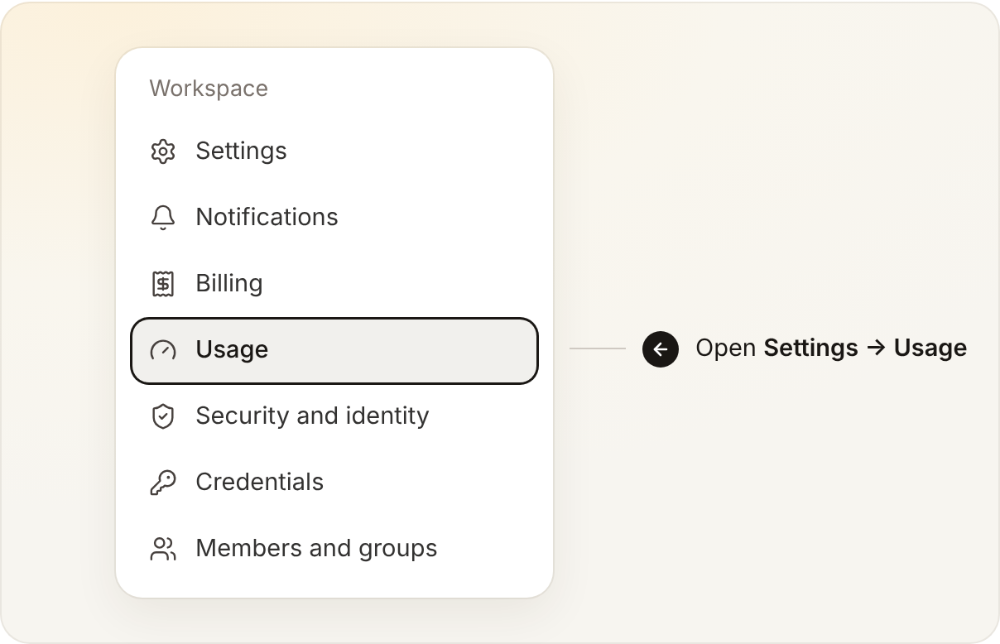
</Frame>

Choose a date range and use the **All users** filter to narrow the view. The summary shows credits used, the credit balance, and the daily average.

<Frame>
  
</Frame>

Under **Where credits went**, hover over or select a day on the chart to see its usage.

<Frame>
  
</Frame>

Use **By agent**, **By member**, or **By model** to see which used the most credits.

<Frame>
  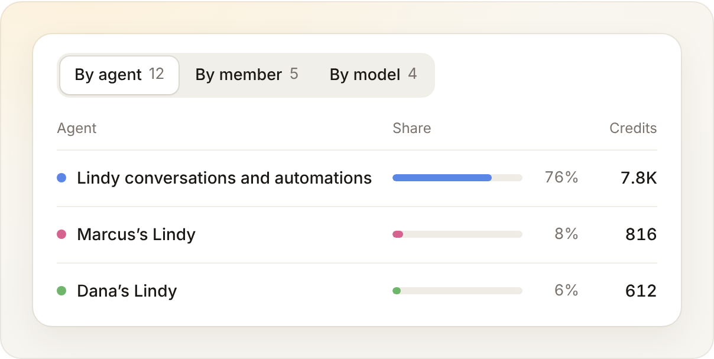
</Frame>

For a quick balance check, look below **Rewards** at the bottom of the Lindy sidebar.

<Frame>
  
</Frame>

To compare teammates in the member list, open **Settings → Members and groups** and select the **Credits** column to sort by usage.

<Frame>
  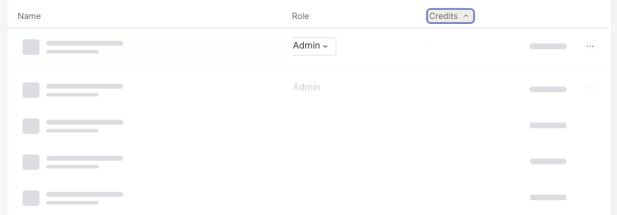
</Frame>

## Spend caps per teammate

Admins can cap how much one person draws from the shared pool, so a single heavy user can't spend the team's month.

In **Settings → Members and groups**, open the **⋯** menu on a member's row and choose **Edit credit limit**.

<Frame>
  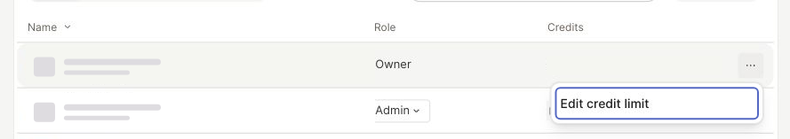
</Frame>

Turn on **Limit credit consumption**, enter a monthly limit, then select **Update credit limit**.

<Frame>
  
</Frame>

- At the limit, Lindy pauses new credit-using actions for that person.
- A task already running can finish, even past the cap.
- With no cap, a teammate can use the whole workspace balance.

<Frame>
  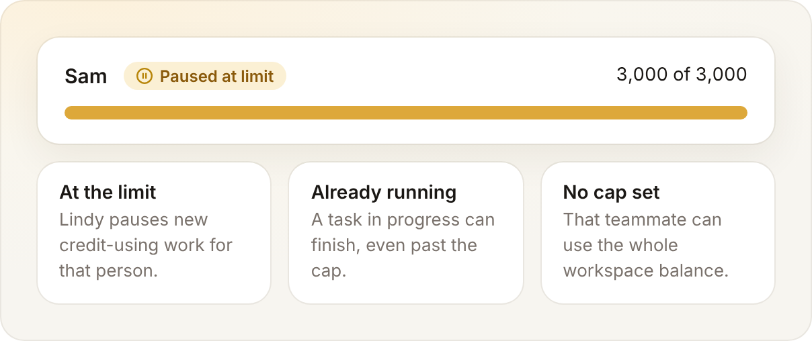
</Frame>

## What Happens When Your Team Hits the Limit?

When the pool runs out, Lindy pauses credit-using work. Admins can buy a top-up or change plans to get more credits before the next reset.

Work can continue once credits are available again, from a top-up, a plan change, or the next billing cycle.

<Frame>
  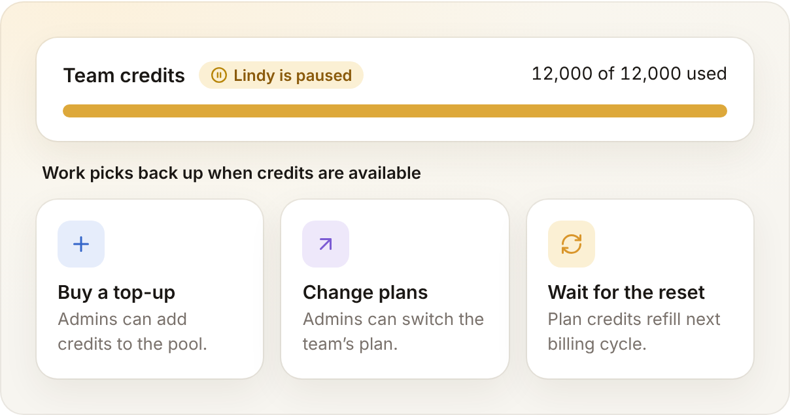
</Frame>

<Accordion title="What if we need more before the pool resets?">
Admins have two options:

1. **Buy a top-up**: extra workspace credits, with current pricing shown in **Settings → Billing**. Purchased top-up credits remain available until you use them.
2. **Change the plan**: review the available plans in **Settings → Billing** and choose one that fits your team's usage.
</Accordion>

<Accordion title="Does adding a teammate add credits?">
Yes. Credits belong to the workspace, not to each person, and every seat adds its tier's allotment to the pool. See [Lindy Teammate Billing](/teammate/lindy-teammate-billing).
</Accordion>

<Accordion title="Can I try Lindy for free?">
New users can start with free credits, no credit card required. The free credits last 7 days.
</Accordion>

If your team keeps hitting the limit, [reach out](mailto:support@lindy.ai) and we'll find the right fit.

## Credit Optimization

Try these ways to make your team's credits go further.

<AccordionGroup>
  <Accordion title="Scope your team sources tightly">
    The shared Lindy searches everything you've approved. Point it at the channels and Drive folders that actually hold your team's answers, not at the whole workspace.

    Open **Settings → Lindy Teammate → Team sources** and prune anything stale. A narrower set of sources is cheaper to search and gives better answers, so this is the rare lever that improves quality and cost at once.
  </Accordion>

  <Accordion title="Review team routines monthly">
    Team routines run on their own schedule whether or not anyone reads the result, and a workspace-wide routine spends for the whole team every time it fires. They're the easiest thing to set up and forget.

    Open the **Routines** page from the left sidebar and review both the **Team** and **Personal** tabs once a month. Flipping a routine off stops it without removing it, so you can turn it back on whenever you want. See [Routines](/teammate/routines).
  </Accordion>

  <Accordion title="Start a new thread for a new topic">
    Every message in a thread re-reads everything above it, so a long-running thread gets more expensive with each turn. This matters more in a busy channel than in a DM, because the whole team keeps adding to it.

    Starting a fresh thread for an unrelated topic keeps every conversation lean. You lose nothing: what Lindy knows from your team's sources carries across every thread.
  </Accordion>

  <Accordion title="Batch related asks into one thread">
    The flip side of the same rule. One thread per topic is the goal, not the fewest threads possible.

    If your team has five questions about the same account, ask them in one thread instead of opening five. If the next question has nothing to do with the last one, start fresh.
  </Accordion>

  <Accordion title="Be specific about what you delegate">
    Deep research is the row in the tables above whose cost genuinely varies, and vagueness is usually the reason. A precise brief tells Lindy when it's done; an open-ended one doesn't.

    - **Costs more**: "@Lindy research Acme."
    - **Costs less**: "@Lindy give me five bullets on Acme's funding history and their last two product launches."

    The same goes for length. If you want a short answer, say so.
  </Accordion>

  <Accordion title="Pick the right model">
    Advanced models earn their cost on hard reasoning and analysis. Routine work like summarizing, drafting, and lookups runs well on a cheaper one.

    Switch the model from the dropdown below the taskbar, then select **Set as default** to apply it to new conversations.
  </Accordion>

  <Accordion title="Remove seats you aren't using">
    A seat stays billed until an admin removes it, and you keep it through the end of the current cycle with no mid-cycle proration. When someone leaves the team, remove them in **Settings → Members**.

    If a removed person @mentions Lindy again, it tells them it can't help and pings an admin. It won't quietly re-add them.
  </Accordion>

  <Accordion title="Check usage weekly">
    A quick look at **Settings → Billing** once a week turns an end-of-month surprise into a small adjustment you make on a Tuesday. Sorting **Settings → Members** by the **Credits** column is how you notice one person or one routine burning more than you expected.
  </Accordion>
</AccordionGroup>

<Frame>
  
</Frame>

<Tip>
You don't have to catch all of this yourself. If a task starts running unusually heavy, Lindy pauses and checks in first. See [Usage Warning](#usage-warning-why-am-i-seeing-this) above.
</Tip>

## Relevant Docs

<CardGroup cols={2}>
  <Card title="Lindy Teammate Billing" icon="credit-card" href="/teammate/lindy-teammate-billing">
    Seats, trials, top-ups, and your shared credit pool
  </Card>
  <Card title="Set up Lindy" icon="slack" href="/teammate/setup">
    Get Lindy into your team's Slack and connect your tools
  </Card>
</CardGroup>

