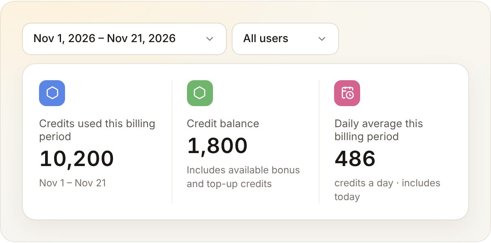
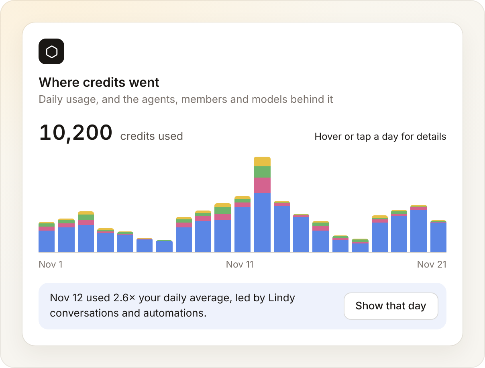
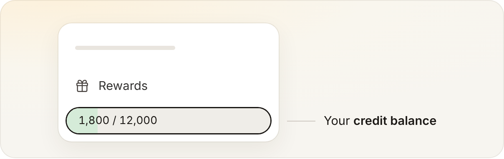
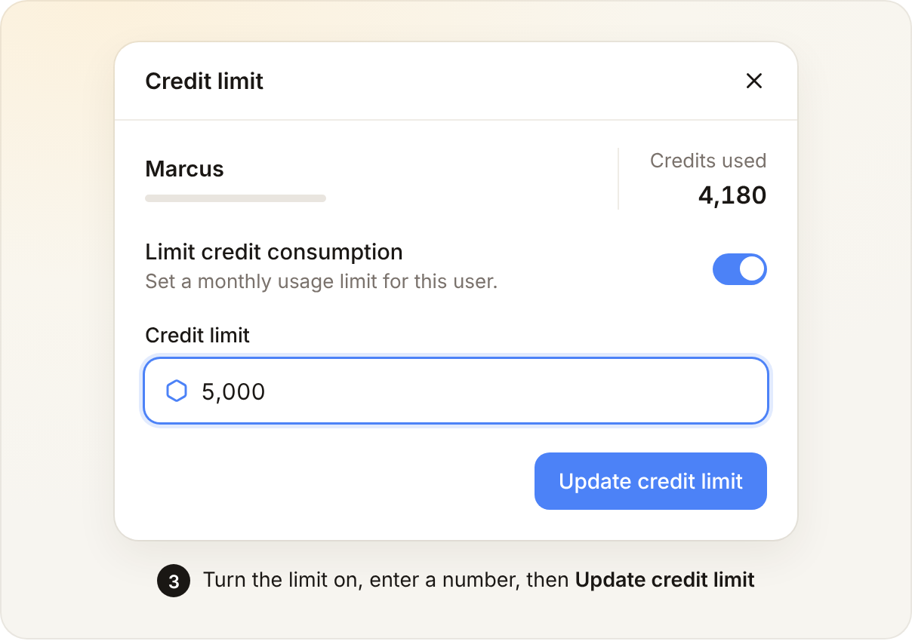
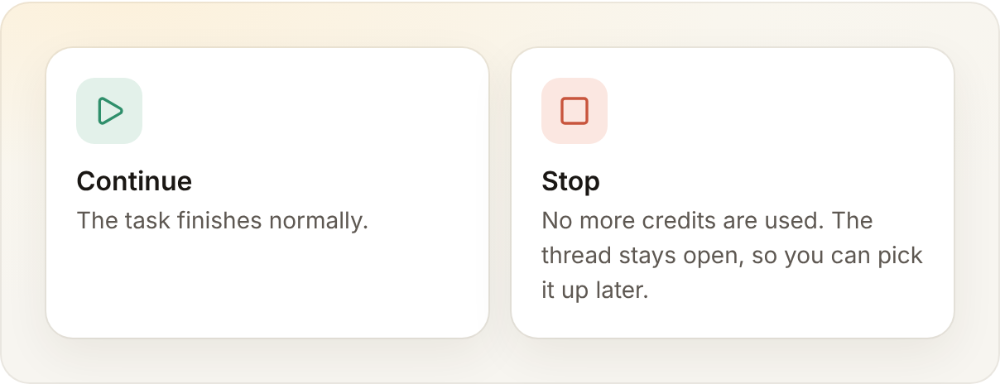
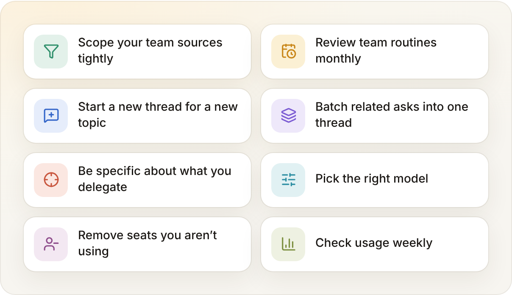

<Frame>
  
</Frame>

Credits measure the work Lindy does. Start with the estimates below, then [check your usage](#checking-your-usage) to see what work used or [find out what to do if work stops](#what-happens-when-your-team-hits-the-limit).

## Credit Usage by Feature

| Type of work | Estimated credits | Examples |
| --- | --- | --- |
| Everyday requests | 2–250 | Summarize a document or look up a record. |
| Deeper work | 250–1,000 | Research a competitor or turn a week of calls into a proposal. |
| Large builds | 1,000–2,500 | Build a dashboard from CRM and analytics data. |

These are [published estimates](https://www.lindy.ai/pricing#how-usage-works). The model, how much context Lindy reads, the length of the output, and extra model or tool calls all affect the actual charge. A connected-app lookup with a zero tool charge can use credits when the model reads or summarizes the result.

[Routines](/teammate/routines) can spend credits each time they run. Meeting recording and [phone calls](/features/phone-line) have separate charging rules.

### How the shared pool works

Paid seats add credits to one workspace pool. Requests in channels and DMs, along with automated work, draw from it. Usage usually counts toward the person who makes the request, including their follow-up in a shared thread. Sponsored group work can count toward the sponsor. A [personal cap](#spend-caps-per-teammate) limits how much one person can draw.

<Frame>
  
</Frame>

### Your team's Lindy, in your channels

Your whole team can ask Lindy to work with approved team sources. The table shows typical credit impact by task.

| What Lindy does | Credit impact |
|---|---|
| Answering a question from approved team sources | Low |
| Pulling a report or a lookup from a connected tool | Low |
| Drafting a client update, summary, or document | Moderate |
| Team routines, priced by how often they run | Moderate |
| Deep research across channels and Drive folders | Varies |

### Your personal Lindy, in your DMs

Personal Lindy handles private requests and automatic updates such as daily briefs and meeting prep.

| What Lindy does | Credit impact |
|---|---|
| Daily brief | Very low |
| Email alerts on time-sensitive mail | Very low |
| Open-loop nudges when an ask goes unanswered | Very low |
| Meeting prep briefings | Very low |
| Catch-up summaries when you're @mentioned in a busy channel | Low |
| Meeting recaps and notes | Low |
| Ad hoc research you delegate in a DM | Varies |
| [Phone calls](/features/phone-line) | From 25 credits per minute |

A purchased Lindy phone number has a separate monthly fee, billed with your plan.

<Frame>
  
</Frame>

Monthly plan credits reset each billing cycle. Purchased top-ups carry over until used. Admins can see current top-up prices in **Settings → Billing**.

<Frame>
  
</Frame>

## Checking your usage

Owners and admins can see the workspace breakdown under **Settings → Billing**. If your settings sidebar has a separate **Usage** item, open **Settings → Usage** for the breakdown.

<Frame>
  
</Frame>

Choose a date range and use the **All users** filter to narrow the view. The summary shows credits used, the credit balance, and the daily average.

<Frame>
  
</Frame>

Under **Where credits went**, hover over or select a day on the chart to see its usage.

<Frame>
  
</Frame>

Use **By agent**, **By member**, or **By model** to see which used the most credits.

<Frame>
  
</Frame>

For a quick balance check, look below **Rewards** at the bottom of the Lindy sidebar.

<Frame>
  
</Frame>

To compare teammates in the member list, open **Settings → Members and groups** and select the **Credits** column to sort by usage.

<Frame>
  
</Frame>

## Spend caps per teammate

Admins can set a monthly credit cap for each teammate.

In **Settings → Members and groups**, open the **⋯** menu on a member's row and choose **Edit credit limit**.

<Frame>
  
</Frame>

Turn on **Limit credit consumption**, enter a monthly limit, then select **Update credit limit**.

<Frame>
  
</Frame>

- At the limit, Lindy pauses new credit-using actions for that person.
- A task already running can finish past the cap. For example, someone who has used 90 of a 100-credit cap can finish a 50-credit task. Their usage reaches 140, and they cannot start another credit-using task until the cap is raised or the next cycle starts.
- With no cap, a teammate can use the whole workspace balance.

<Frame>
  
</Frame>

## What Happens When Your Team Hits the Limit?

| What happened | What to do |
| --- | --- |
| Lindy asks to keep spending on a task | [Choose **Continue** or **Stop**](#usage-warning-why-am-i-seeing-this). |
| You reached your member cap | Ask an owner or admin to raise it, or wait for the next cycle. A workspace top-up leaves your personal cap in place. |
| The workspace ran out of credits | An owner or admin can buy a top-up or change the plan in **Settings → Billing**. |

Some billing interruptions require an updated payment method or a plan change. Eligible runs can resume after billing is fixed. If a run expires, check what it already completed before rerunning it.

<Frame>
  
</Frame>

### Usage Warning: Why Am I Seeing This?

When spending checks are enabled for your workspace, Lindy can pause a task that's using more credits than usual. If you asked in Slack, look for the prompt in the channel thread or DM where you delegated it.

- Select **Continue** to let Lindy finish the task.
- Select **Stop** to end work on that run. Credits for work already done can still appear in usage.

<Frame>
  
</Frame>

<Accordion title="What if we need more before the pool resets?">
Admins have two options:

1. **Buy a top-up**: extra workspace credits, with current pricing shown in **Settings → Billing**. Purchased top-up credits remain available until you use them.
2. **Change the plan**: review the available plans in **Settings → Billing** and choose one that fits your team's usage.
</Accordion>

<Accordion title="Does adding a teammate add credits?">
Yes. Credits belong to the workspace, not to each person, and every seat adds its tier's allotment to the pool. See [Lindy Teammate Billing](/teammate/lindy-teammate-billing).
</Accordion>

<Accordion title="Can I try Lindy for free?">
New users can start with free credits, no credit card required. The free credits last 7 days.
</Accordion>

If your team keeps hitting the limit, [reach out](mailto:support@lindy.ai) and we'll find the right fit.

## Credit Optimization

Try these ways to make your team's credits go further.

<AccordionGroup>
  <Accordion title="Scope your team sources tightly">
    The shared Lindy searches everything you've approved. Point it at the channels and Drive folders that actually hold your team's answers, not at the whole workspace.

    Open **Settings → Lindy Teammate → Team sources** and prune anything stale. A narrower set of sources is cheaper to search and gives better answers, so this is the rare lever that improves quality and cost at once.
  </Accordion>

  <Accordion title="Review team routines monthly">
    Team routines run on their own schedule whether or not anyone reads the result, and a workspace-wide routine spends for the whole team every time it fires. They're the easiest thing to set up and forget.

    Open the **Routines** page from the left sidebar and review both the **Team** and **Personal** tabs once a month. Flipping a routine off stops it without removing it, so you can turn it back on whenever you want. See [Routines](/teammate/routines).
  </Accordion>

  <Accordion title="Start a new thread for a new topic">
    Every message in a thread re-reads everything above it, so a long-running thread gets more expensive with each turn. This matters more in a busy channel than in a DM, because the whole team keeps adding to it.

    Starting a fresh thread for an unrelated topic keeps every conversation lean. You lose nothing: what Lindy knows from your team's sources carries across every thread.
  </Accordion>

  <Accordion title="Batch related asks into one thread">
    The flip side of the same rule. One thread per topic is the goal, not the fewest threads possible.

    If your team has five questions about the same account, ask them in one thread instead of opening five. If the next question has nothing to do with the last one, start fresh.
  </Accordion>

  <Accordion title="Be specific about what you delegate">
    Deep research is the row in the tables above whose cost genuinely varies, and vagueness is usually the reason. A precise brief tells Lindy when it's done; an open-ended one doesn't.

    - **Costs more**: "@Lindy research Acme."
    - **Costs less**: "@Lindy give me five bullets on Acme's funding history and their last two product launches."

    The same goes for length. If you want a short answer, say so.
  </Accordion>

  <Accordion title="Pick the right model">
    Advanced models earn their cost on hard reasoning and analysis. Routine work like summarizing, drafting, and lookups runs well on a cheaper one.

    Switch the model from the dropdown below the taskbar, then select **Set as default** to apply it to new conversations.
  </Accordion>

  <Accordion title="Remove seats you aren't using">
    When someone leaves the team, manage their seat in **Settings → Members and groups**. Review the workspace subscription in **Settings → Billing**.
  </Accordion>

  <Accordion title="Check usage weekly">
    Check the [workspace usage breakdown](#checking-your-usage) each week. Sort **Settings → Members and groups** by **Credits** to see which teammates are using the most.
  </Accordion>
</AccordionGroup>

<Frame>
  
</Frame>

## Relevant Docs

<CardGroup cols={2}>
  <Card title="Lindy Teammate Billing" icon="credit-card" href="/teammate/lindy-teammate-billing">
    Seats, trials, top-ups, and your shared credit pool
  </Card>
  <Card title="Set up Lindy" icon="slack" href="/teammate/setup">
    Get Lindy into your team's Slack and connect your tools
  </Card>
</CardGroup>

