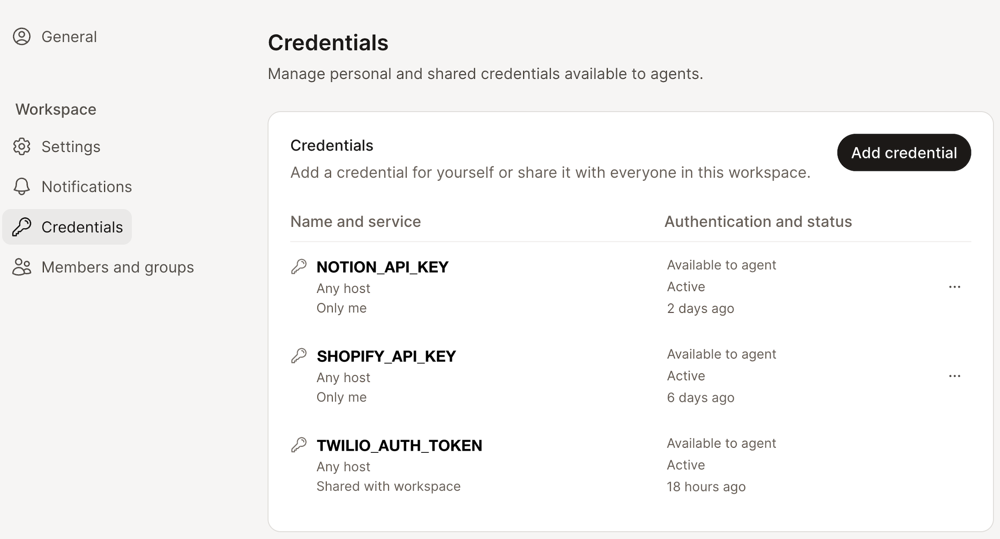
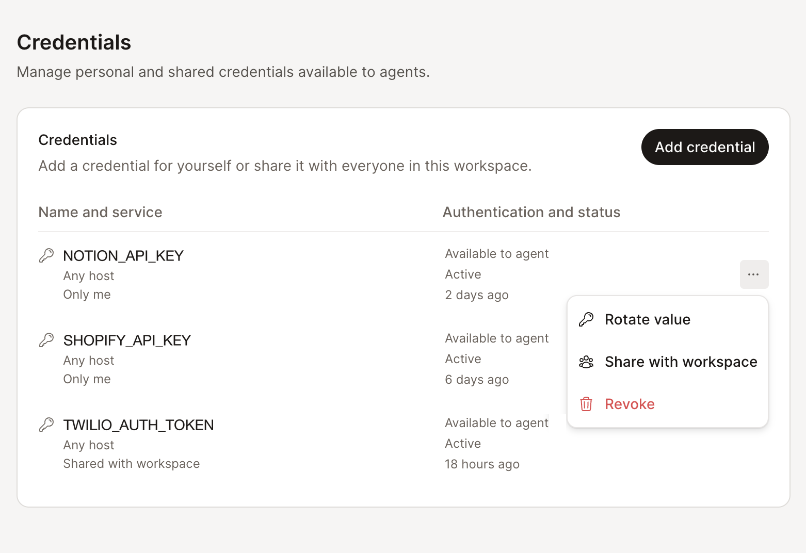

<Frame>
  
</Frame>

Save a credential when Lindy needs a key to call an API or a login to sign in to a website. Use the credential form in Lindy and keep secrets out of chat.

## Save an API key or token

<Steps>
  <Step title="Open Add credential">
    On **Integrations**, select **API**. You can also open **Settings → Credentials** to manage saved credentials.
  </Step>
  <Step title="Enter the key">
    Give it a **Display name** and paste it into **API key or token**. Use a key with the permissions Lindy needs for the job.
  </Step>
  <Step title="Save">
    Check **Who can use it?**, then select **Add credential**. Eligible agents can read the key during a task and send it to an API host.
  </Step>
</Steps>

The name is how you and Lindy refer to the key later, so make it obvious what it opens. Existing credentials follow `SCREAMING_SNAKE_CASE`:

| Good | Why |
| --- | --- |
| `NOTION_API_KEY` | Names the tool and the kind of credential |
| `STRIPE_RESTRICTED_KEY` | Distinguishes it from a full-access key |
| `key1` | Tells you nothing six months from now |

## Save a website login

Where **Browser** is available on **Integrations**, select it to open **Add login credential**. Enter a display name, website, username or email, and password. Check **Who can use it?**, then select **Add credential**.

Lindy's browser uses the login when a task opens the site. Lindy's AI does not see the password.

## Reading the list

Each row tells you two things: what the credential is, and whether it's working.

| Column | What it shows |
| --- | --- |
| **Name and service** | The credential's name, the host it applies to, and who can use it: **Only me** or **Shared with workspace** |
| **Authentication and status** | Whether it's **Available to agent**, whether it's **Active**, and when it was last updated |

A rotated credential is easy to spot: its updated time moves, its name doesn't.

## Rotating and sharing

Open the **...** menu on any credential row.

<Frame>
  
</Frame>

| Action | What it does |
| --- | --- |
| **Rotate value** | Replaces the key with a new one. The name stays the same, so nothing that refers to the credential needs to change. |
| **Share with workspace** | Hands the credential to everyone in the workspace. The row flips from **Only me** to **Shared with workspace**, and other people's agents can use it without ever seeing the value. |
| **Revoke** | Removes the credential. Anything relying on that key stops being able to authenticate, so rotate rather than revoke if the tool is still in use. |

<Tip>
  Rotating and sharing are separate decisions. Rotating a shared credential keeps it shared: everyone simply starts using the new value.
</Tip>

## What Lindy shows you, and what it doesn't

The credential settings show its name, who can use it, and when it was last updated. The saved value is hidden after you add it. Eligible agents can still use a saved API key for their work.

| You can see | You cannot see |
| --- | --- |
| The credential's name | The credential's value |
| Its host and visibility | |
| When it was last updated | |

<Warning>
  Keep the original in a password manager or another secure place you control. If you lose an API key, create a fresh one with the service and rotate the saved credential.
</Warning>

## Credentials and integrations

Credentials and [integrations](/integrations/overview) solve the same problem from different ends.

| | Integration | Credential |
| --- | --- | --- |
| **How you connect** | OAuth, or an API key entered during setup | An API key you save yourself |
| **Scope** | Personal, or shared with the team | Personal, or shared with the workspace |
| **Guardrails apply** | Yes | No |
| **Value readable later** | No | No |

If the tool you want is already in the integrations list, connect it there. Reach for a credential when the thing you're calling has no integration of its own.
