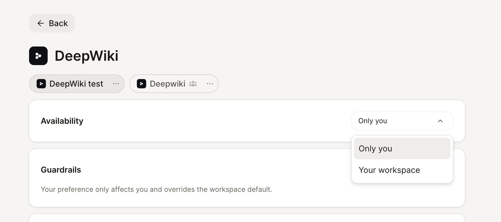
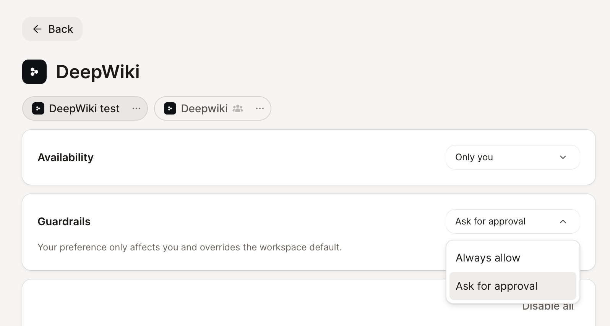

Connect a hosted MCP server to give Lindy access to the tools it publishes. Check [Integrations](/integrations/overview) for a built-in connection first. To use Lindy from Claude, ChatGPT, Codex, or another AI app, follow [Use Lindy from other AI apps](/integrations/lindy-mcp-server).

Lindy connects to hosted servers that expose a public HTTPS streamable-HTTP endpoint. On connect it reads the server's tool catalog and creates an action for every tool whose schema it supports. There is no action-picking or field-mapping step: everything supported arrives switched on, and you turn off what you don't want afterwards. A small server might add three tools; a large one adds well over a hundred.

## Adding an MCP server

<Steps>
  <Step title="Get the server URL">
    Look for the MCP link in the tool's documentation. It should look like `https://mcp.example.com/mcp` and must be reachable over public HTTPS. Enter any static key separately under **Advanced**.
  </Step>
  <Step title="Open the MCP dialog">
    In **Integrations**, select **MCP server**. If you see **+ Add**, open it and choose **MCP**.
  </Step>
  <Step title="Paste the link">
    In **Connect MCP server**, paste the link into **MCP link** and optionally add a **Display name**.
  </Step>
  <Step title="Set up authentication if needed">
    If the server requires an API key or token, open **Advanced** and use **Send as** to select the form the provider expects. Lindy supports an Authorization bearer token, a custom header, and a query parameter. For OAuth, leave **Advanced** empty and follow the sign-in prompt after you select **Connect**.
  </Step>
  <Step title="Connect">
    Select **Connect**. After any sign-in is complete, open the server in **Integrations** to check its tool counts.
  </Step>
</Steps>

<Tip>
  A **Display name** is worth setting. Connections are identified by hostname otherwise, and several products serve more than one server from the same host, so two entries can look identical in the list. `Linear production` beats a bare hostname.
</Tip>

<Note>
  Lindy shows two numbers: the tools the server reports, and the tools available in Lindy. They differ when a server publishes tools whose schemas Lindy doesn't support. Zero available means the endpoint is wrong, the catalog is empty, or none of the tool definitions are compatible.
</Note>

## After you connect

Open the server from **Integrations** to reach its settings. Every connection you hold to that server appears as a chip across the top, so one product can carry more than one: a personal connection and a shared one, each with its own settings. A chip marked with a people icon is shared with the workspace. Its **...** menu is where you rename or remove that connection.

Three cards sit below.

### Availability

**Availability** decides who the connection serves.

<Frame>
  
</Frame>

| Setting | Who can use its tools |
| --- | --- |
| **Only you** | Your Lindy alone. Every new connection starts here. |
| **Your workspace** | Everyone in the workspace, and Lindy Teammate |

### Guardrails

**Guardrails** decide whether Lindy asks before it uses the server.

<Frame>
  
</Frame>

| Setting | What Lindy does |
| --- | --- |
| **Always allow** | Calls the server's tools without asking |
| **Ask for approval** | Asks first |

This one is personal. Your choice affects only you, and it overrides whatever the workspace has set as its default, so two people on the same shared server can run it differently.

### Actions

**Actions** lists every tool Lindy built from the server's catalog, each with the description the server publishes and a toggle. They all arrive on.

Turn off the ones you don't need. **Disable all** clears the list in one click, which is the fast way to keep two tools out of a hundred. This is worth doing on a large server: every enabled tool is a tool Lindy has to consider on every task, and a hundred unused ones are noise.

## Who can change what

Sharing is the connection owner's call. Workspace owners and admins set team policy and can revoke sharing, but they cannot grant it or reconnect the credential on your behalf.

| | Connection owner | Workspace owner or admin | Other members |
| --- | --- | --- | --- |
| Use the tools | Yes | Once shared | Once shared |
| Set Availability to the workspace | Yes | No | No |
| Revoke sharing, set policy | Yes | Yes | No |
| Reconnect the credential | Yes | No | No |

Guardrails are the exception: that setting is per person, so anyone using a shared server picks their own.

## Turning a server off

Setting a shared connection's **Availability** back to **Only you** removes its tools from everyone else's Lindy in that workspace. The connection itself survives and keeps working for you, and the same server connected separately elsewhere is unaffected.

Reach for the **Actions** toggles first if the problem is noise rather than access. Dropping to **Only you**, or removing the connection from its **...** menu, is for when the team should not be calling that server at all.
