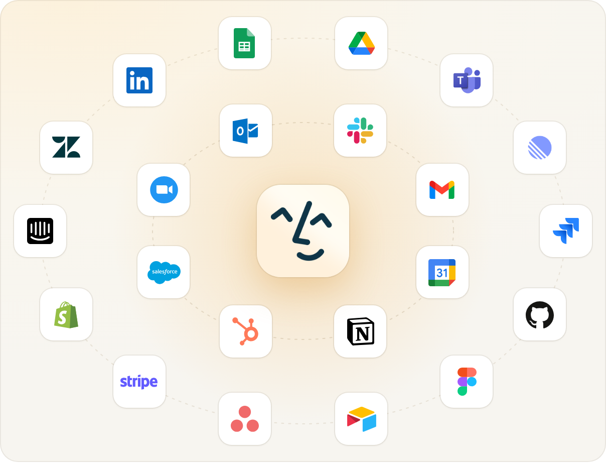
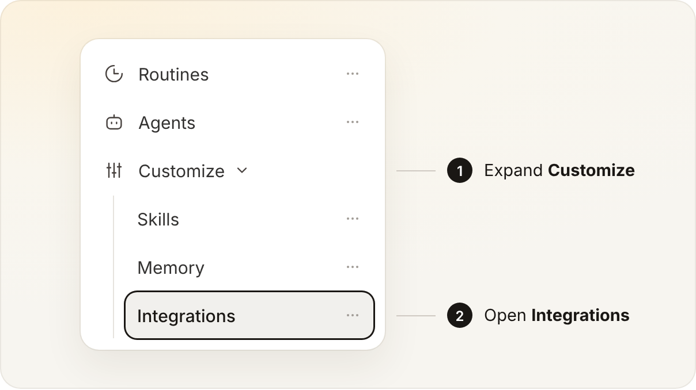
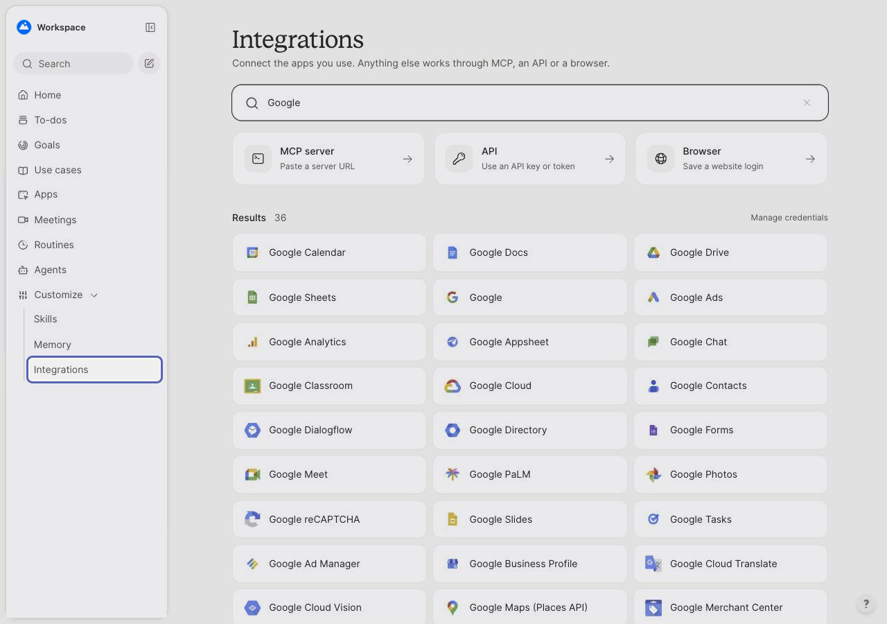
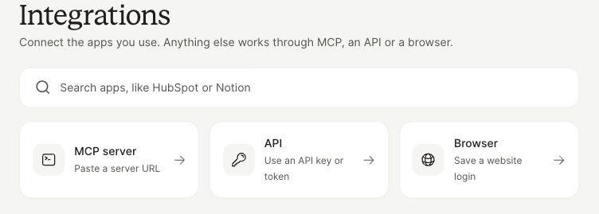

## Find Integrations

Open **Integrations** in the Lindy sidebar. If you don't see it, expand **Customize** in the sidebar and select **Integrations**. You can also go to **Settings → Integrations**.

<Frame>
  
</Frame>

<Accordion title="See it in the full app">
  <Frame>
    
  </Frame>
</Accordion>

## Connect an app

Use **Search apps** to find a tool by name, or start with **Popular** to see commonly used tools and what's already connected. Lindy supports **3,000+ integrations**. You can also [browse the full catalog](https://www.lindy.ai/integrations).

  <Frame>
    
  </Frame>

Select the app you want to use, then follow its sign-in or API key instructions. Start with the tools Lindy needs for the job, like Google Sheets for client reports or HubSpot for lead research. Some integrations let you add more than one account.

## When a tool isn't in the list

| Choose | When to use it |
| --- | --- |
| **MCP server** | The tool publishes a hosted MCP link. [Connect the server to Lindy](/integrations/mcp). |
| **API** | The service gives you an API key or token. [Save it as a credential](/integrations/credentials#save-an-api-key-or-token). |
| **Browser** | Lindy needs to sign in to a website to do the job. [Save a website login](/integrations/credentials#save-a-website-login) where Browser is available. |

To use Lindy from Claude, ChatGPT, or another AI app, open **Settings → AI apps**. See [Use Lindy from other AI apps](/integrations/lindy-mcp-server).

## Personal and team connections

| Scope | Who can use it | Who can change it |
| --- | --- | --- |
| **Personal** | Just you | You |
| **Team** | Everyone in the workspace | Owners and admins |

A personal connection is private to you. Your Lindy uses it for your own work, your DMs, and the web app.

An owner or admin can share one of their personal connections with the whole workspace. From then on, everyone's Lindy reads that tool as that account and acts with its permissions. Members can see team connections but can't change them.

## When Lindy asks for approval

Whether Lindy asks depends on the action, where the job runs, and any saved approval settings. Some actions can require approval in a personal conversation or during a routine. If you want to review a result yourself, ask Lindy to leave it as a draft. For a routine, [start with a dry run](/teammate/routines#test-with-a-dry-run).

## Guardrails

In shared Slack threads, integration guardrails control actions that make a change, such as updating a CRM record. Use these settings to decide when Lindy should ask first.

| Setting | What Lindy does in shared Slack threads |
| --- | --- |
| **Always allow** | Allows writes without this approval step |
| **Require approval** | Asks in Slack before writing |
| **Don't offer** | Hides write actions for this tool |

The shared Slack settings apply to writes. Read-only actions like looking up a record can run with the access already granted to Lindy.

## Approving a write in Slack

When Lindy needs approval, it posts **Approve** and **Deny** buttons in the thread. The person who asked can approve their own request, and so can any workspace owner or admin. Anyone else gets a private note to ask one of them.

**Approve** allows that one action and changes nothing else. **Always allow** changes the rule going forward: workspace-wide if an owner or admin clicks it, or just for that person if a member does.

## Manage and reconnect accounts

Open an integration to manage its accounts. Where available, you can add another account, rename it, change who can use it, or disconnect it.

If a connection appears under **Needs attention**, select **Reconnect** and sign in again. Use **Manage credentials** to see the API keys and website logins available to you.
