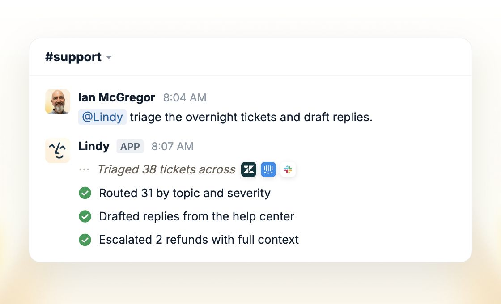

Pick one job you already do. This guide uses a weekly client update as an example.

<Steps>
  <Step title="Connect the tools for your first job">
    In the [Lindy web app](https://chat.lindy.ai/), open **Integrations** and connect the tools Lindy needs. For a client update based on a spreadsheet, start with Google Sheets. [Browse integrations](/integrations/overview) to find the tools for your job.
  </Step>
  <Step title="Give Lindy the job">
    Open **Home**. Pick a suggestion or describe what you want back. For example, ask:

    > Use the Client Results spreadsheet to draft this week's update for Acme. Include what changed, what shipped, and what's next. Leave the draft here for me to review.

    Replace the spreadsheet and client names with your own. For more prompts, see [Use cases](/use-cases).
  </Step>
  <Step title="Review the result">
    Check the draft and ask for any changes in the same conversation. If you'll need the same update next week, ask Lindy to set up a [routine](/teammate/routines#create-your-own).
  </Step>
</Steps>

## More ways to use Lindy

- **Work with your team in Slack.** An admin can [add Lindy to Slack](/teammate/setup#1-connect-your-accounts). Once your account is linked, @mention Lindy in a channel to work together or DM it for your own work.
- **Text Lindy from your phone.** [Set up iMessage or SMS](/features/imessage-sms).
- **Use email and calendar.** [Connect your Google or Microsoft account](/teammate/setup#1-connect-your-accounts) for inbox help, meeting prep, and scheduling.

<Frame>
  
</Frame>

## Next steps

<CardGroup cols={2}>
  <Card title="Set up Lindy" icon="slack" href="/teammate/setup">
    The full team and account setup
  </Card>
  <Card title="Home" icon="house" href="/teammate/home">
    Where you talk to Lindy and see what it's done
  </Card>
  <Card title="Meetings" icon="video" href="/teammate/meeting-library">
    Recording, notes, and your shared library
  </Card>
  <Card title="Billing" icon="credit-card" href="/teammate/lindy-teammate-billing">
    Seats, credits, and the shared pool
  </Card>
</CardGroup>
