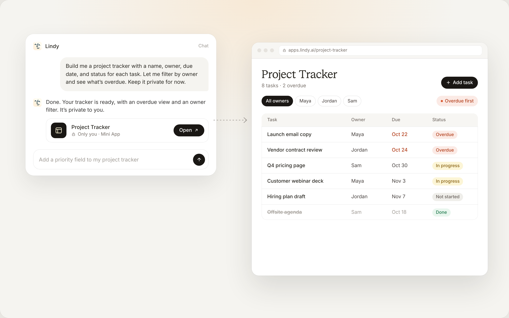
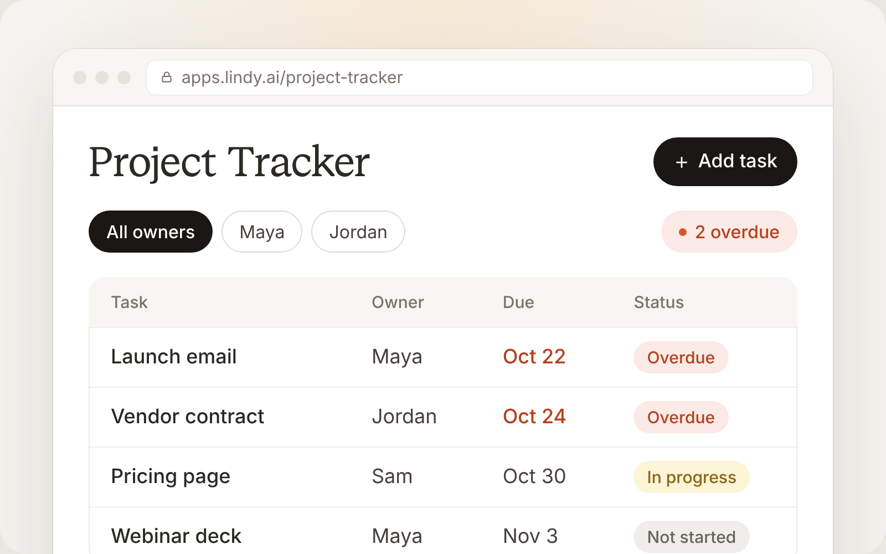
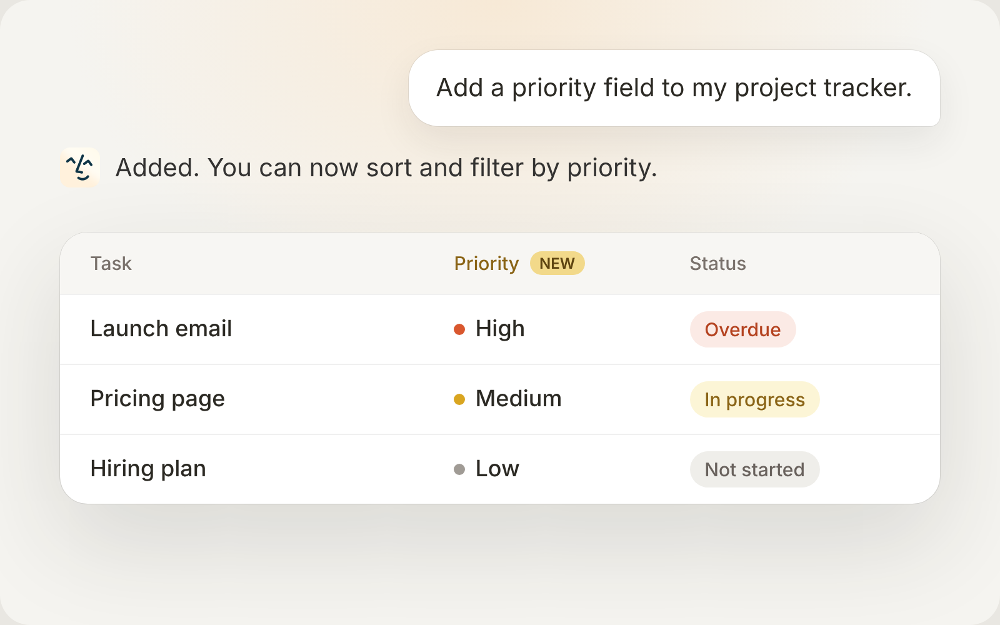
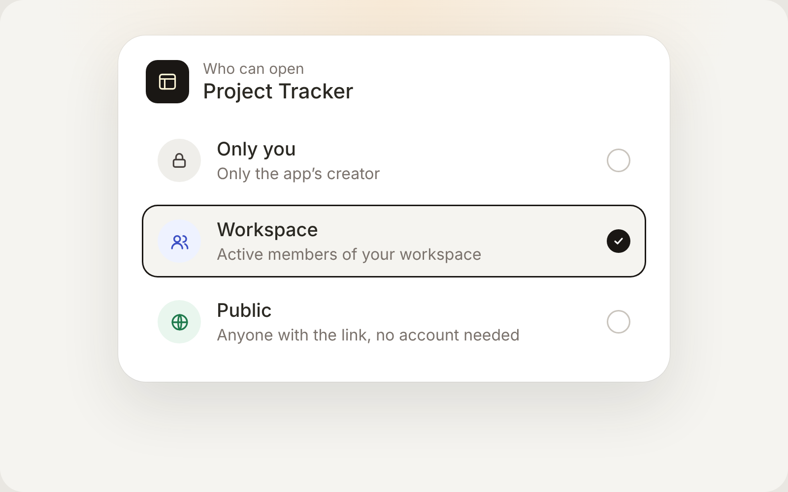

Apps are web apps Lindy builds for you and your team. Describe what you need, such as a project tracker, a customer dashboard, or a request form. Lindy builds the app and gives you a link to open it in your browser.

Open **Apps** in the Lindy sidebar to find apps you've created and apps shared with your workspace.

<Note>
  Apps are in a pilot, so they aren't on for every account yet. If **Apps** says "Apps are not available for this account yet," your account doesn't have access.
</Note>

## Create an app

Ask Lindy in chat. Explain what the app should do, what information it needs, and who will use it.

> Build me a project tracker with a name, owner, due date, and status for each task. Let me add and update tasks, filter by owner, and see what's overdue. Keep it private for now.

<Frame>
  
</Frame>

Open the link Lindy returns and try it with a few example entries. Apps can save data, so you can come back to the same app and continue where you left off.

<Frame>
  
</Frame>

Start with the essentials. You can add more fields, views, or features as you use it.

## Make changes

Tell Lindy which app to update and describe the change. You can adjust its layout, add fields, change how it works, or update its data.

For example:

- "Add a priority field to my project tracker."
- "Show overdue tasks at the top and add a filter for this week."
- "Add a board view grouped by status."

<Frame>
  
</Frame>

Open the app again to review the result.

## Choose who can use it

Ask Lindy to keep an app private, share it with your workspace, or make it public. On the **Apps** page, **Personal** lists apps you created, **Workspace** lists apps shared with the workspace, and **Shared with me** lists the ones other people created.

| Visibility | Who can open the app |
| --- | --- |
| **Only you** | Only the app's creator. |
| **Workspace** | Active members of your workspace. |
| **Public** | Anyone with the link, without a Lindy account. |

For example: *"Share my project tracker with the workspace so the team can use it."*

<Frame>
  
</Frame>

The app's creator and workspace owners or admins can manage it. Sharing an app doesn't give everyone permission to change its design or settings.

For what visitors can do, how sign-in works, and what updates live, see [Share an app](/teammate/apps-sharing).

## Use data from your tools

If your app needs data from another service, tell Lindy which service and what the app should read or change. An app needs its own permission to use saved API credentials; connecting a tool to Lindy doesn't automatically give every app access.

Review that access alongside the app's audience, since it can let people using the app work with the connected service.

## Restore a previous version

On the **Apps** page, open the **More options** menu (**...**) on an app you manage and choose **Version history**. Choose **Restore** beside an earlier version, or **Undo last change** to return to the previous one.

Restoring puts that version's code back live as a new version, and takes about a minute. Lindy keeps the latest 50 versions. The app's saved data stays as it is; restoring a version doesn't undo changes to records or recover deleted data.

## Relevant Docs

<CardGroup cols={2}>
  <Card title="Share an app" icon="share-nodes" href="/teammate/apps-sharing">
    Private, workspace, and public apps, sign-in, and what updates live
  </Card>
  <Card title="Limits and troubleshooting" icon="triangle-exclamation" href="/teammate/apps-limits-troubleshooting">
    App limits, usage pauses, failed builds, and deleting apps
  </Card>
</CardGroup>
