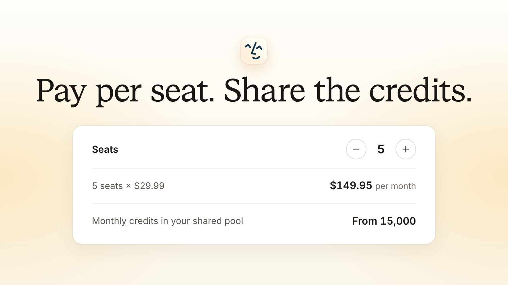
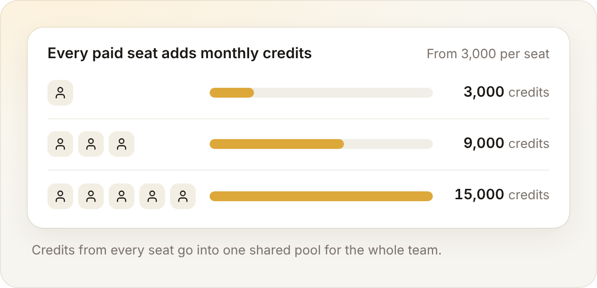
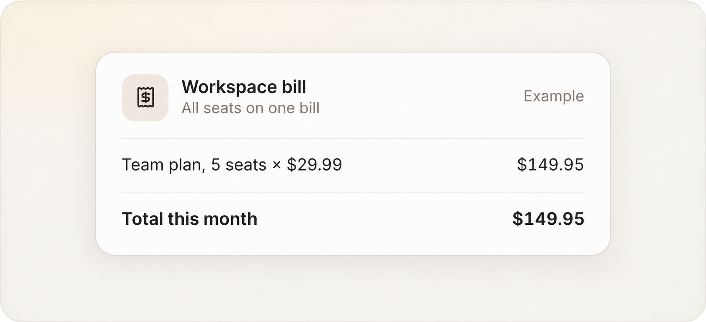
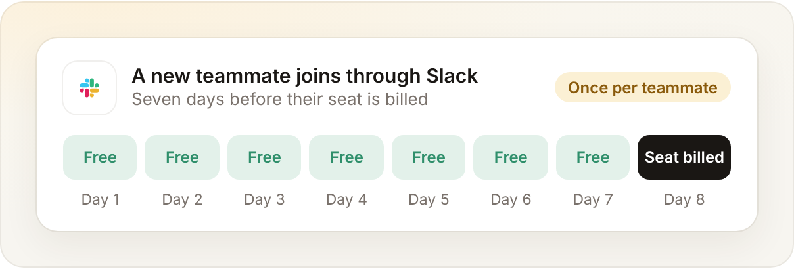
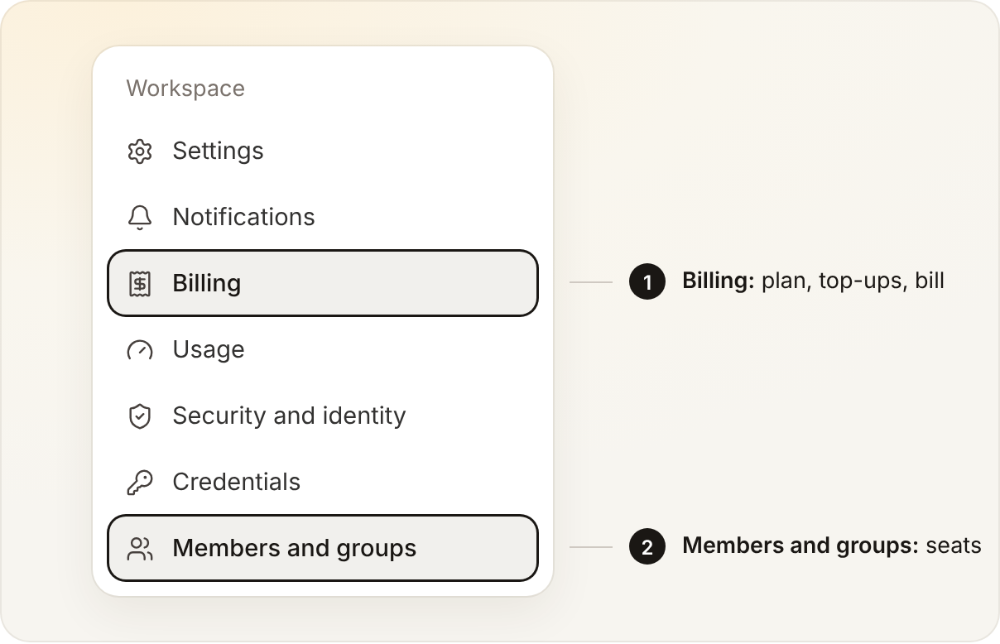
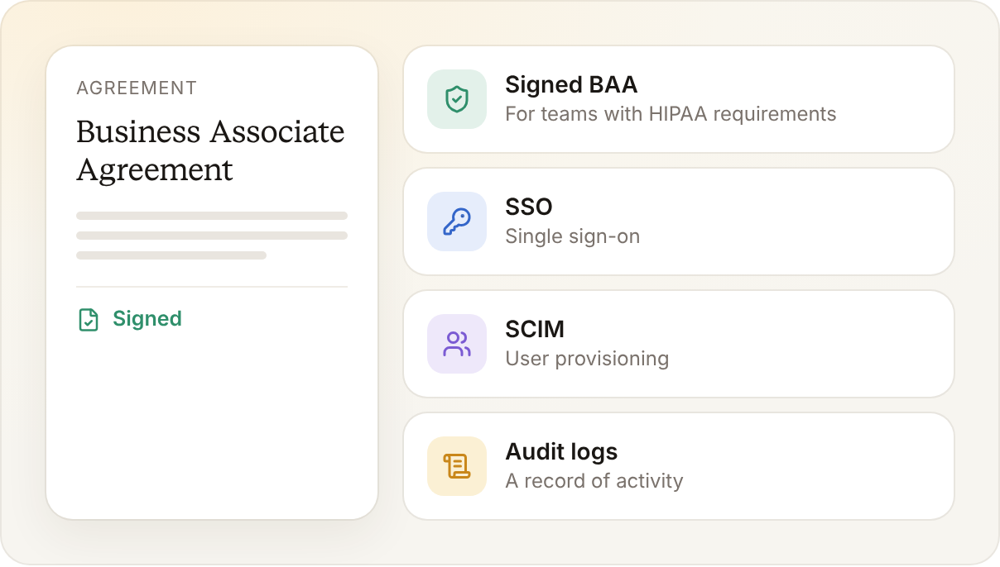

<Frame>
  
</Frame>

## Plans and credits

  <section className="billing-plan">
    <h3>Free</h3>
    
&#36;0

    
Try Lindy with &#36;50 in credits for seven days.

    <a href="https://chat.lindy.ai/signup">Try for free</a>
  </section>
  <section className="billing-plan billing-plan-team">
    <h3>Team</h3>
    
&#36;29.99 <small>per seat per month</small>

    
From 3,000 monthly credits per seat.

    <a href="https://www.lindy.ai/pricing">See pricing</a>
  </section>
  <section className="billing-plan">
    <h3>Enterprise</h3>
    
Custom

    
Custom credits and billing, plus a signed BAA for teams with HIPAA requirements.

    <a href="https://www.lindy.ai/contact-sales">Book a demo</a>
  </section>

Team pricing is shown per month. If annual billing is available for your workspace, you'll see it when you choose a plan in **Settings → Billing**. For custom annual terms, [talk to Enterprise sales](https://www.lindy.ai/contact-sales).

### Top-ups

Need more credits? Admins can see top-up prices, buy credits, or change the plan in **Settings → Billing**. Top-ups stay in your balance until you use them.

See [Credits and usage](/account-billing/usage) to check spending, estimate task costs, and set limits.

## Seats

Every paid seat adds monthly credits to your team's shared pool.

<Frame>
  
</Frame>

You pay for each active user as a seat on one workspace bill.

<Frame>
  
</Frame>

New teammates who join through Slack get seven days free before their seat is billed. Each teammate gets one trial.

<Frame>
  
</Frame>

To manage seats, go to **Settings → Members and groups**. To manage your plan, top-ups, and bill, go to **Settings → Billing**.

<Frame>
  
</Frame>

## Enterprise with a signed BAA

Get a signed **Business Associate Agreement (BAA)** for your team's HIPAA requirements, along with SSO, SCIM, and audit logs. [Talk to Enterprise sales](https://www.lindy.ai/contact-sales).

<Frame>
  
</Frame>
