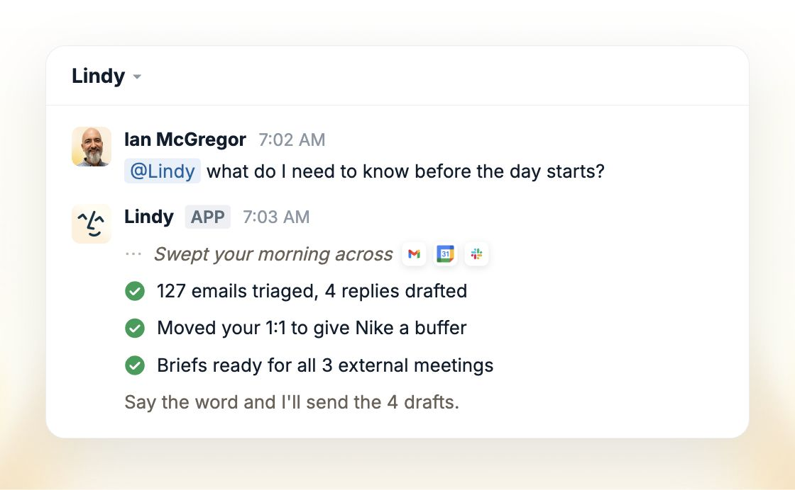
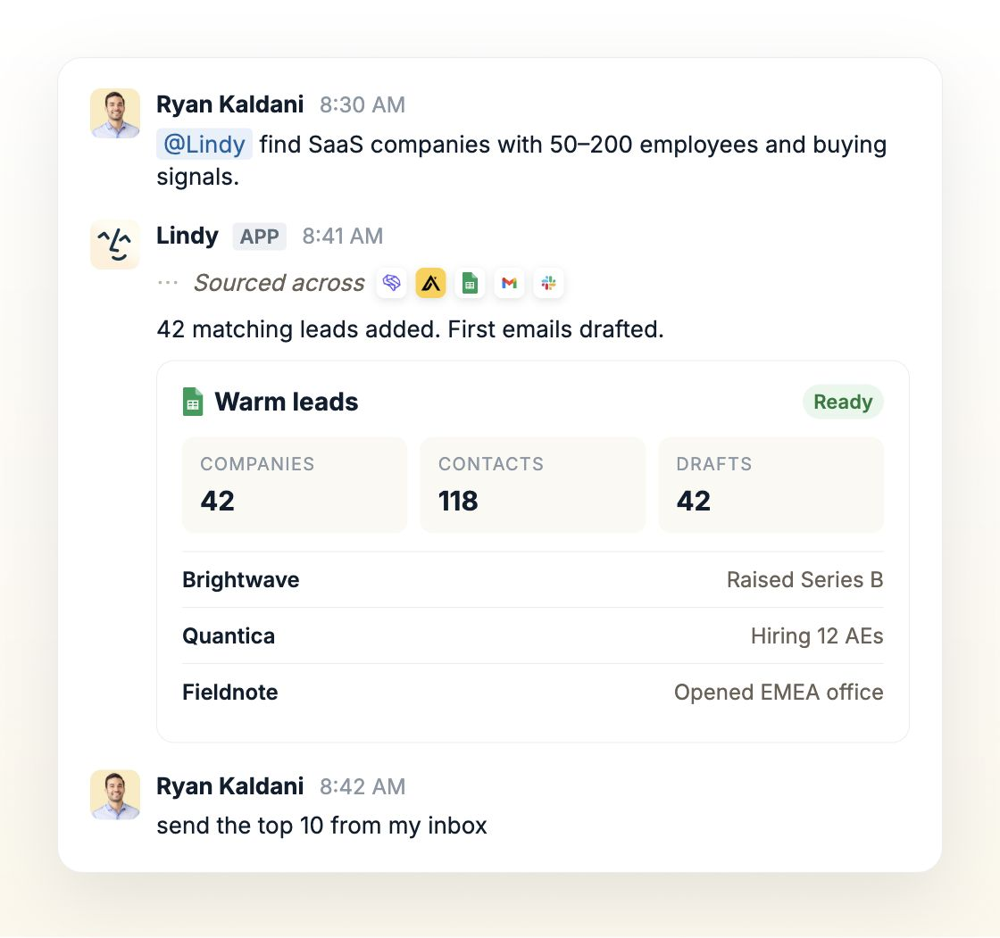
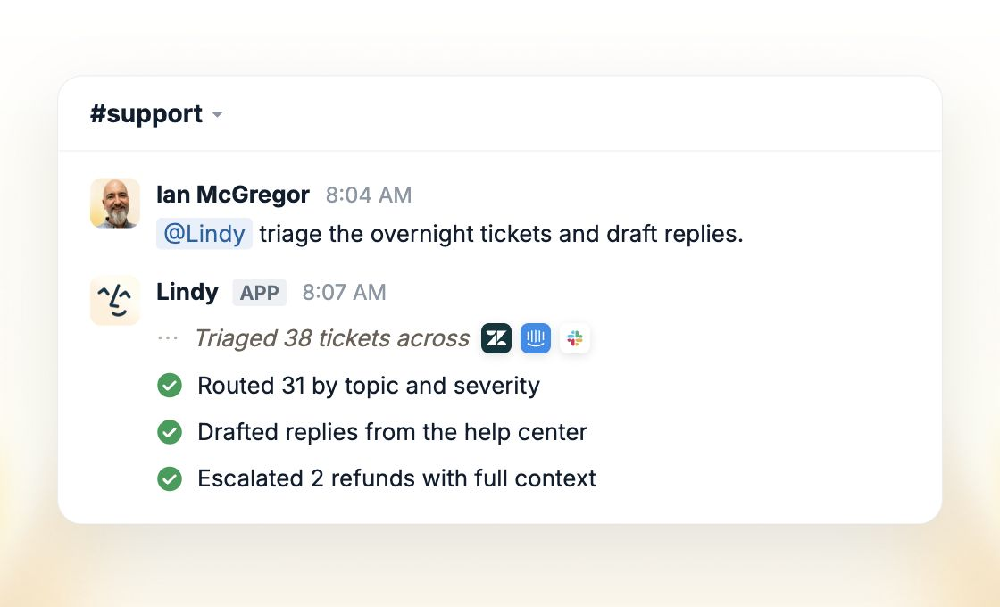
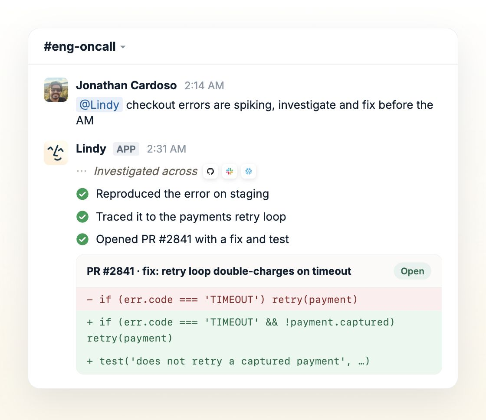
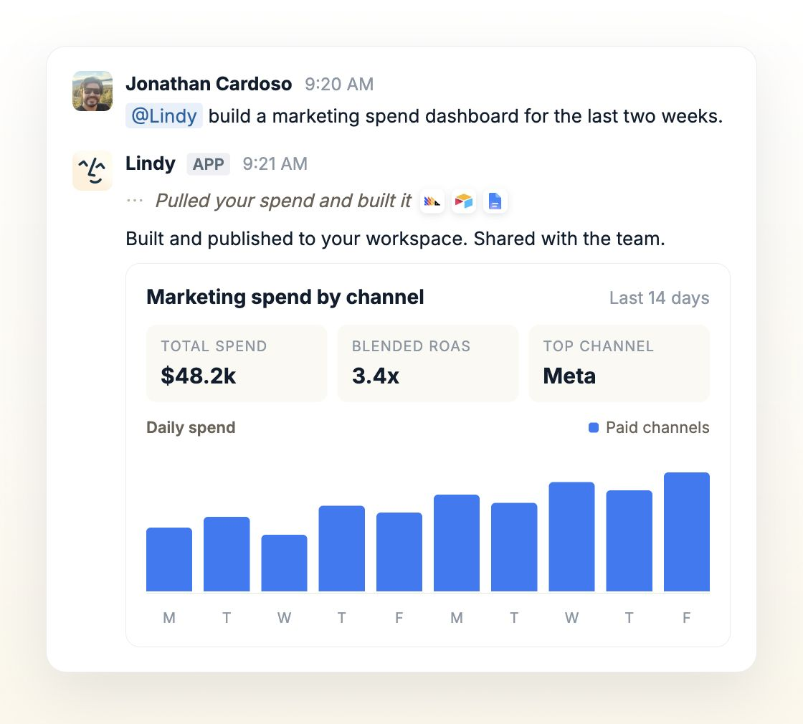
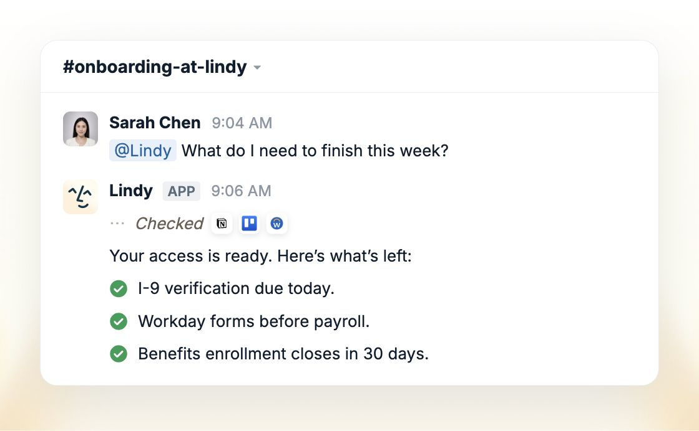
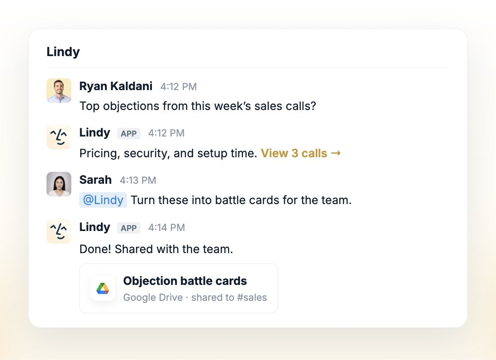
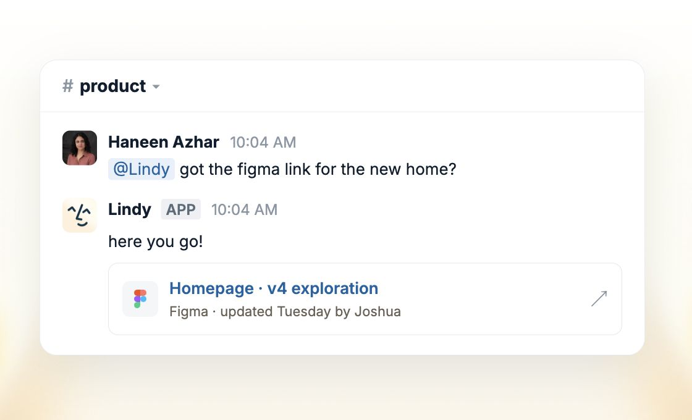
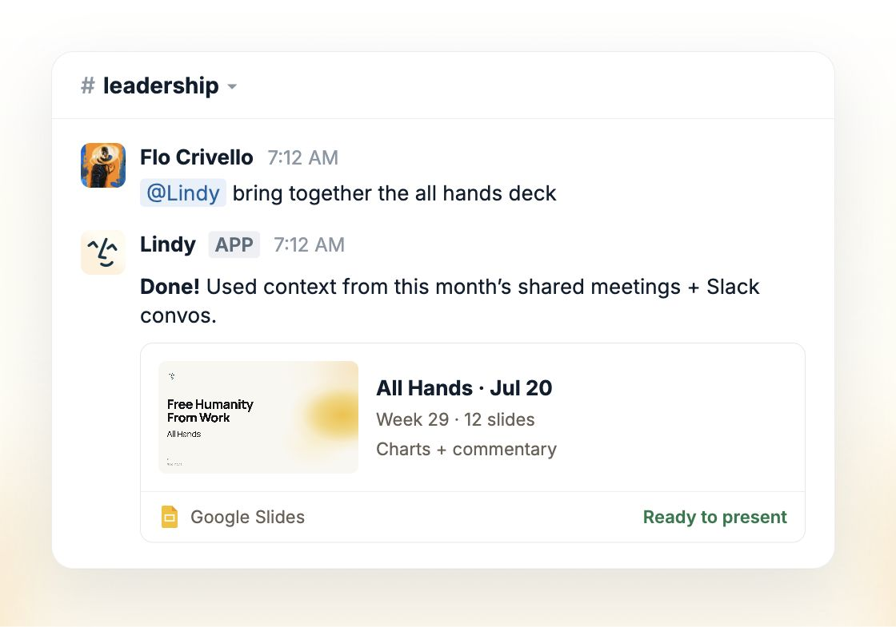
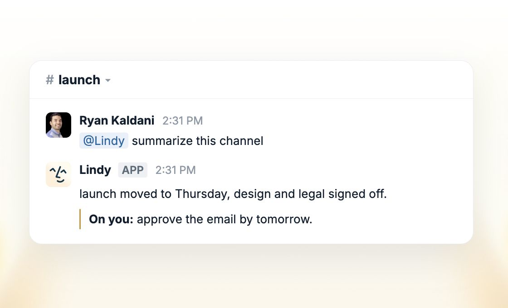

<Frame>
  <video
    src="/lindy-brand-assets/teammate/use-cases-overview-v4.mp4"
    poster="/lindy-brand-assets/teammate/use-cases-overview-v4-poster.png"
    controls
    playsInline
    preload="metadata"
    style={{ maxHeight: "none", aspectRatio: "16 / 9" }}
    aria-label="Lindy use cases overview"
  />
</Frame>

Start with a job you already do. Pick an example in the app or use one of the prompts below to tell Lindy what to work on and what you want back.

## Find a starting point in Lindy

Open **Use cases** in the Lindy sidebar. Browse categories such as **Marketing**, **Sales & client management**, and **Operations & finance**, or use **Search use cases** to find a role or job.

Select **See how it works** on a card to see the tools it uses and what you could ask Lindy to do first. Choose **Try in chat** to open a Lindy conversation with a starter prompt for that job. Include the accounts or files to use and the result you want to review.

## Draft a client update

Connect Google Sheets, then try this in Lindy chat:

> Use the Client Results spreadsheet to draft this week's update for Acme. Include what changed, what shipped, and what's next. Leave the draft here for me to review.

Replace the spreadsheet and client names with your own. If you write the same update every week, [set it up as a routine](/teammate/routines#create-your-own).

## Inbox and calendar

Inbox management, scheduling, prep, meetings.

  

## Sales and client management

Lead enrichment, follow-ups, CRM updates, pipeline management.

  

## Customer service

Ticket triage, routing, drafted replies, escalation.

  

## Product and data

Ticket triage, bug investigation, code review, oncall.

  

## Marketing

Dashboards, reporting, attribution, competitive tracking, customer stories.

  

## Operations and finance

Ask Lindy to check open invoices against their due dates and recent payments, then draft a follow-up for overdue accounts.

> List the invoices that are overdue, grouped by customer. Include the current balance, due date, and source. Leave follow-up drafts here for me to review.

## People

Onboarding, tickets, screening, feedback.

  

## Meetings

Ask about any call, then act on what you learn.

  

## More examples

Not tied to a role. Anyone on the team can ask for these.

### Find answers

Ask across Slack, meetings, and your tools. Lindy digs up the answer and the file or decision behind it.

  

### Build decks

Hand Lindy the deck. It pulls from your meetings and tools and comes back with slides, charts, and commentary, ready to present.

  

### Catch up

Been out, or dropped into a busy channel? Lindy gives you the TL;DR and exactly what needs you.

  

<CardGroup cols={2}>
  <Card title="Set up Lindy" icon="slack" href="/teammate/setup">
    Get it into Slack and link the team.
  </Card>
  <Card title="Skills" icon="graduation-cap" href="/teammate/skills">
    Teach it the ones you repeat.
  </Card>
</CardGroup>
